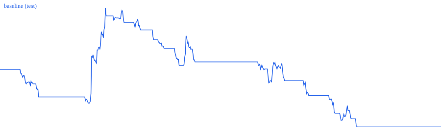

# Backtest evaluation

Generated 2026-10-22T10:17:33.486724+00:00. Data source: **binance_proxy** (PROXY — not Wallex prices or fills)
Train 2026-02-24 → 2026-08-03 · Test (held out) 2026-08-03 → 2026-10-22
Families: DONCHIAN_TREND · timeframes [3600, 14400] s · cost model {'fee_fraction': '0.0035', 'half_spread_bps': '8', 'slippage_bps': '5'}

| run | net_return_pct | net_pnl_tmn | max_drawdown_pct | trades | win_rate | profit_factor | avg_pnl_per_trade_tmn | avg_net_bps_per_trade | fees_tmn |
|---|---|---|---|---|---|---|---|---|---|
| baseline_train | -12.028 | -601386 | 12.264 | 69 | 0.246 | 0.229 | -8716 | -105.0 | 405495 |
| baseline_test | -3.31 | -165520 | 7.008 | 46 | 0.283 | 0.693 | -3598 | -30.0 | 279863 |

## 3-day episode returns (each episode = one simulated competition)

| run | episodes | mean % | median % | worst % | best % | share positive |
|---|---|---|---|---|---|---|
| baseline_train | 53 | -0.241 | 0.0 | -1.421 | 1.037 | 0.038 |
| baseline_test | 26 | -0.126 | 0.0 | -1.256 | 2.904 | 0.154 |

## Edge artifact (train split, consumed by the selector on test)

```json
{
 "DONCHIAN_TREND": {
  "trades": 69,
  "mean_net_bps": -105.0,
  "lcb5_net_bps": -142.4,
  "win_rate": 0.246,
  "profit_factor": 0.257,
  "period_utc": [
   1771894800,
   1785718800
  ],
  "source": "proxy backtest (train split)"
 }
}
```

## Fee sensitivity (test, baseline)

| taker fee | net % | max DD % | trades | PF | avg bps |
|---|---|---|---|---|---|
| 0.0035 | -3.31 | 7.008 | 46 | 0.693 | -30.0 |
| 0.0025 | -1.957 | 6.377 | 46 | 0.813 | -9.9 |
| 0.0015 | -0.288 | 5.576 | 46 | 0.971 | 10.1 |
| 0 | 2.851 | 3.972 | 46 | 1.314 | 40.2 |



Limitations: proxy prices/liquidity differ from Wallex TMN books; fills are modeled, not observed; a single chronological split is a small sample; the selected configuration was chosen on the train split only.
